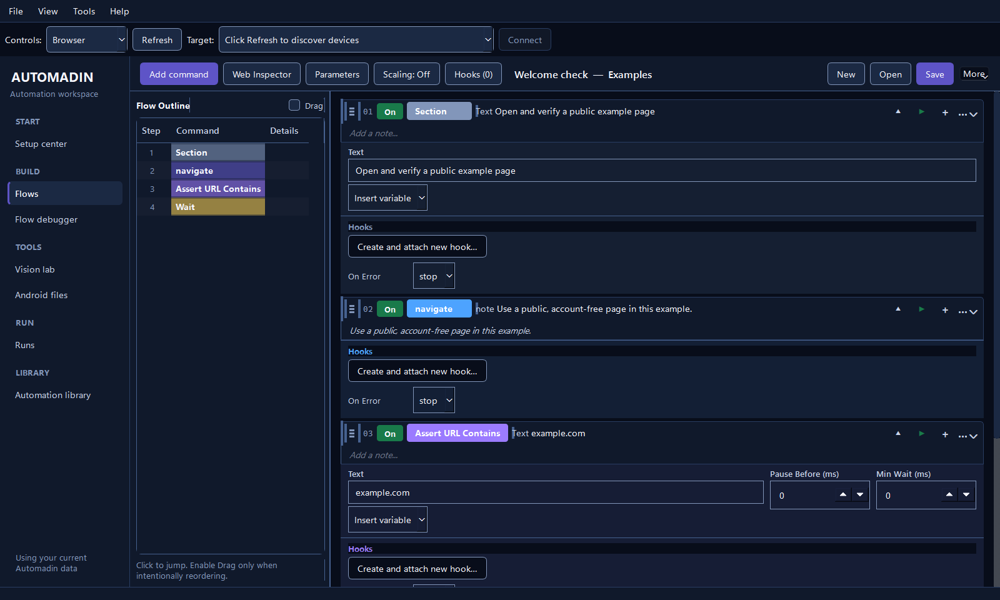
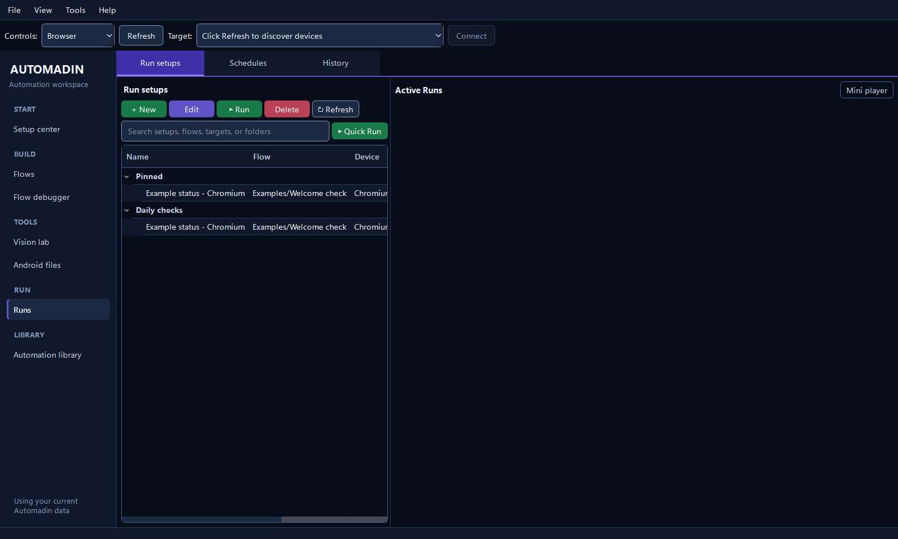

# Automadin

Automadin is a Windows desktop application for designing automation as visual,
reusable flows. Instead of placing an entire task in one script, you arrange
target-aware commands into readable steps, branches, loops, and subflows, then
run them against websites, Android devices, or native Windows applications.

Flows can mix direct browser or application control with screenshots, template
matching, dynamic visual targets, and screen-text recognition. Typed inputs,
variables, outputs, hooks, retries, and explicit error policies help a small
automation grow into a maintainable workflow. The same tested flow can be run
interactively, launched from a saved setup, or scheduled for unattended use.

## What it can do

- Build and reorganize nested flows with conditions, loops, switch branches,
  subflows, comments, reusable hooks, and per-step error handling.
- Automate browsers with resilient element locators, tabs, navigation, form
  input, text extraction, assertions, page selection, and JavaScript.
- Drive Android through ADB, manage application lifecycle and deep links, and
  inspect files on a connected device.
- Reacquire or launch native Windows applications, then click, drag, type,
  scroll, press keys, and use image-relative actions within their windows.
- Capture screenshots, maintain template-image libraries, find static or moving
  visual targets, and read text, numbers, or timers from selected regions.
- Declare typed inputs, variables, and outputs; prompt for values at launch; and
  pass data between reusable flows.
- Debug with preflight checks, breakpoints, step runs, live logs, pause/stop
  controls, and detailed command-level errors.
- Save target-specific run setups, schedule recurring runs, inspect history, and
  send Pushover or Telegram notifications.
- Organize resources into a library and create complete portable or database-only
  backups for safe transfer between installations.

Automadin currently targets **Windows x64**. Browser automation needs a supported
browser runtime; Android automation needs ADB and a connected device or emulator.
The in-app Setup Center reports exactly what is ready on the current computer.

## See Automadin

### Design a flow



The flow editor combines a navigable outline with expandable command cards,
parameters, comments, hooks, scaling options, and focused step-run controls.

### Save and operate runs



The Runs workspace keeps reusable launch configurations, schedules, history, and
currently active runs together. Both screenshots use disposable synthetic data.

## Get started

1. Download the installer from [Releases](https://github.com/ouzture/automadin/releases).
2. Open **Setup center** and choose Browser, Android, or Windows automation.
3. Follow [Create your first flow](https://ouzture.github.io/automadin/user-guide/first-flow/).

> [!WARNING]
> Automadin's current Windows binaries are unsigned while the project applies
> for free open-source signing through SignPath Foundation. Windows may show
> **Unknown publisher** or a SmartScreen warning. Verify the SHA-256 hashes on
> the release page before running a download. See the
> [code signing policy](CODE_SIGNING_POLICY.md).

The [complete user guide](https://ouzture.github.io/automadin/) covers setup,
flow building, all target types, images and OCR, debugging, schedules, backups,
privacy, and every available command.

## Development

```powershell
python -m pip install -e ".[dev,docs]"
python -m playwright install chromium
python -m pytest -q
python -m ruff check automadin tests main.py
python -m mkdocs serve
python main.py --data-dir .
```

Application databases, browser profiles, logs, and backups can contain private
data. Keep them outside source control. See [CONTRIBUTING.md](CONTRIBUTING.md),
[SECURITY.md](SECURITY.md), and the maintained
[developer documentation](docs/project-overview.md).

## License

Copyright © 2026 ouzture. Automadin's original source and assets are licensed
under the GNU General Public License, version 3 only (`GPL-3.0-only`). See
[LICENSE](LICENSE). Distributed third-party components retain their own licenses.
Public binary releases must include matching Corresponding Source for Automadin,
Qt, and Qt for Python as described in [the distribution guide](docs/distribution.md).
