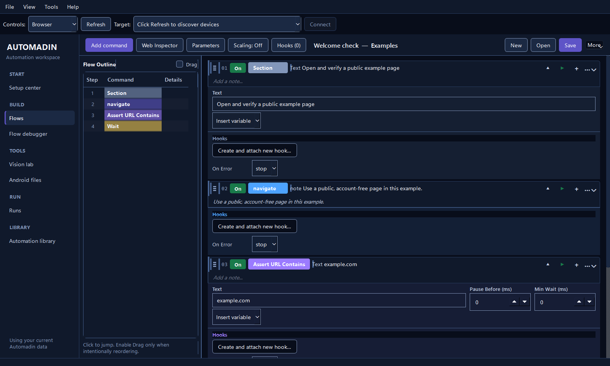

# Create your first flow

This tutorial creates a small browser flow that opens a public page, checks its
address, and pauses briefly. It does not require a saved browser profile or an
account.

## 1. Prepare a browser target

In **Setup center**, choose Browser and make sure at least one browser is usable.
In the target bar at the top of Automadin, select that browser. A managed
Chromium target is a straightforward first choice.

## 2. Create the flow

1. Open **Flows** from the left navigation.
2. Select **New** and name the flow `Examples/Welcome check`.
3. Select **Add command**, search for **Navigate To**, and add it.
4. Set **URL** to `https://example.com/`.
5. Add **Assert URL Contains** and set its expected text to `example.com`.
6. Add **Wait** and use a short duration such as 500 ms.
7. Select **Save**.

Commands run from top to bottom. The URL assertion gives the flow an explicit
success condition instead of assuming navigation worked.

*The example uses only the public `example.com` page and contains no account data.*

## 3. Run and inspect

Run the flow from the editor or open **Flow debugger**, choose
`Examples/Welcome check`, and start it. Watch the status and log:

- If preflight reports a blocker, correct it before continuing.
- A breakpoint pauses before its command.
- **Pause**, **Stop**, and **Run again** control the current debug run.
- A failed step includes its command identity and error details.

## 4. Make it reusable

After the flow works in the debugger:

1. Open **Runs** and choose **Quick Run** for a one-off launch; or
2. Create a **Run setup** to save the flow, target, and input policy together.

Run setups are the stable unit used by schedules. See
[Run setups and schedules](run-setups-and-schedules.md).

## What to try next

- Use **Click Element** and **Input Fill** for a browser form.
- Add an **If Value** or **For** block and place commands inside it.
- Declare an Input so the same flow can receive different values at launch.
- Create a small second flow and call it with **Run Flow**.
