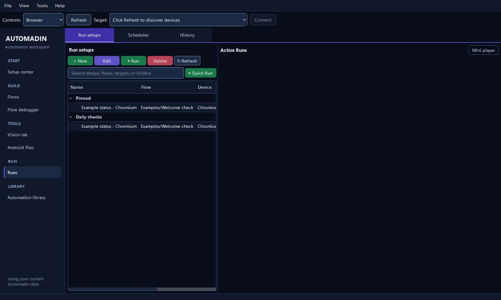

# Run setups and schedules

## Quick Run

Use **Runs > Quick Run** to choose a flow and target for a one-off launch. This is
useful after debugging when you do not yet need a saved operational setup.

## Saved run setups

A run setup stores a name, flow, target selection, flow-input behavior, and other
launch choices. Use a descriptive name such as
`Daily checks/Example status - Edge`.

Choose whether each input should keep its configured value or prompt at launch.
Test the saved setup manually before attaching a schedule.

*Names and targets in documentation screenshots are synthetic examples.*

## Schedules

Schedules refer to a saved run setup. Create them from the **Schedules** tab,
choose the recurrence and local time, and review the next expected run. Keep
Automadin's scheduler running for scheduled flows to start.

On Windows, **Tools > Start scheduler when I sign in** configures startup for the
current account. A scheduled run still depends on its target, runtime, profile,
network, and application being available at execution time.

## History and notifications

The **History** tab records scheduled-run outcomes. Configure Pushover or Telegram
through **Tools**, then add **Send Notification** to the success or failure path
where a remote signal is useful.

Do not include passwords, tokens, private page content, or unnecessary personal
data in notification messages. Emergency Pushover priority repeats until
acknowledged and should be reserved for genuinely urgent events.
